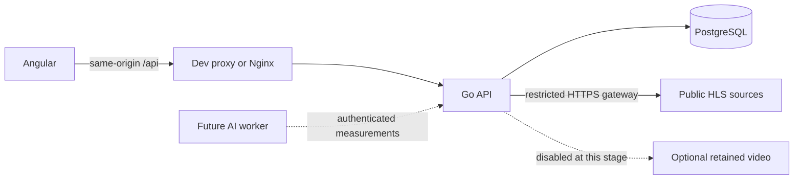

# TrafficBet Demo

[](https://github.com/TykhonRepeshko/trafficbet-demo/actions/workflows/checks.yml)

**A full-stack traffic prediction app with virtual credits, live road cameras and an auditable balance ledger.**

Built with **Go, Angular 21 and PostgreSQL 16**, packaged as separate Docker Compose services. Users predict whether a vehicle count will finish above a round's threshold. The project demonstrates transactional account operations, authorization, safe media delivery and a preparation workflow for future computer vision.

**Current stage:** working local portfolio prototype. Credits have no monetary value. AI detection, tracking and automatic settlement are not connected; public production deployment is not configured. Retained-video capture and its annotation workspace are paused to avoid local video storage.

## What it does

- **Accounts:** registration, password sign-in, persistent balances, prediction history, password changes and session revocation. Registration opens an account with 10,000 virtual credits.
- **Predictions:** scheduled rounds, fixed odds, server-enforced deadlines, stake debit, reviewed settlement and cancellation with a one-time refund. Per-user idempotency protects against duplicate submissions.
- **Cameras:** six curated HLS views across Norway and the United States, reconnection handling, source resolution reporting and counting-line overlays in previews and fullscreen. Geometry appears after an operator configures a camera; drafts are labelled.
- **Administration:** user search and pagination, camera archive/restore, schedule configuration, live stake totals and participant/outcome drill-down. API authorization protects administration independently of navigation visibility.
- **Counting preparation:** versioned rules, reference frames, source observations, round review and an audit trail. Retained-video capture/playback and the annotation workspace are disabled at this stage; historical metadata remains preserved.
- **Interface:** responsive Angular pages, light/dark themes and a visible How it works guide. Stakes and results are calculated on the server.

For example, a winning **100 cr** prediction at **1.90** returns **190 cr including the stake**. A losing prediction returns zero; cancellation refunds the original 100 cr. Over means strictly greater than the threshold; Under or equal includes equality.

## Architecture



Go owns account permissions, credits, scheduling and source access. PostgreSQL transactions and row locks serialize competing credit operations; unique ledger records and idempotency keys prevent repeated payouts/refunds/debits. Published rules and accepted round terms remain fixed.

Angular provides the interface and calls relative `/api` paths. It receives scoped media URLs instead of upstream configuration. Nginx serves the production frontend and proxies requests to Go. Docker runs migrations with a separate owner login, then starts the API with a restricted database role.

| Component | Version / purpose |
| --- | --- |
| Go | 1.26.10 minimum; HTTP API, scheduling, media gateway |
| Angular / TypeScript | 21 / 5.9; standalone components and RxJS |
| Node.js | 24 for frontend builds and regression tests |
| PostgreSQL | 16; persistent data, constraints and SQL migrations |
| Nginx / Docker Compose | Frontend delivery and isolated service deployment |
| FFmpeg / ffprobe | Optional bounded retained-video processing, currently disabled; no AI inference |

## Run locally

### Fresh checkout: Docker

Install **Docker Desktop with the Linux engine running** and **PowerShell 7**. From the repository root in PowerShell 7:

```powershell
.\scripts\setup.ps1
docker compose up --build -d
```

Open **[http://localhost:4200](http://localhost:4200)**. Only this loopback frontend port is published; API and database ports stay inside Docker networks. The first build compiles the restricted video decoder and can take several minutes.

Setup generates independent random credentials in the ignored `.env`. For the optional local seed, use `admin@example.com` with `DEMO_ADMIN_PASSWORD`, or `player@example.com` with `DEMO_PLAYER_PASSWORD`; read these values privately from your own `.env`. There are no shared passwords. Existing account credentials are preserved. Use `/register` for a normal account and `/admin` for administrator access.

```powershell
docker compose down                 # Stop; retain saved data
docker compose up --build -d         # Rebuild and start after source changes
```

PostgreSQL and optional retained footage use separate named volumes. Video capture defaults to `VIDEO_EVIDENCE_ENABLED=false`, and its volume remains empty during normal use. **Do not add `-v` to normal shutdown commands:** deleting volumes removes stored data. Fresh volumes have no operator-created counting profiles or annotations.

### This prepared Windows workspace: native mode

```powershell
.\start.cmd
.\stop.cmd
```

This mode uses the separately prepared Go/Node/PostgreSQL/video tools on this computer. Those runtimes are not included in Git. Go binds `127.0.0.1:8080`, PostgreSQL binds `127.0.0.1:55433`, and Angular serves `localhost:4200`.

The launcher keeps an existing native database as the default. Stop native mode before using Docker on the same frontend port. **Native storage and Docker storage are independent**: switching modes does not migrate accounts. Keep `.env` and `.local-data/postgres` private and backed up together. If video storage is reintroduced, retained files must accompany their database snapshot. See [verified transfer and recovery](docs/23-docker-verification.md).

## Rounds, video and AI boundaries

Default automatic rounds have **30 seconds for predictions → 120-second safety gap → 30 seconds for counting**. Administrators can change future schedules in seconds. Go must remain running to publish new rounds; the scheduler does not invent counts or settle results.

A stream that plays successfully does not prove exact sensor capture time or complete footage. Source operators can interrupt, reposition or blur a camera. There is no intentionally added delay buffer, and public camera access cannot prevent somebody watching the operator's source independently.

Versioned capture-UTC settlement requires matching retained evidence, complete verified coverage and a trusted capture-time anchor. **The current public sources do not establish that trusted anchor.** Unverifiable rounds must be cancelled and refunded. Clip-relative annotations support offline evaluation; they are not a completed training dataset or proof of counting accuracy.

The intended AI extension is a separate detector/tracker worker that applies the frozen crossing rule and submits authenticated interval measurements. Its output will still need quality and settlement checks. See [current AI prerequisites](docs/20-local-preparation.md).

On 25 October, local retained-video storage was released and immutable retirement records were added. Historical capture/annotation metadata remains, while retired media is excluded from playback, annotation, settlement evidence, storage budgets and new transfer bundles. Reintroducing evidence must cover the entire counting interval (currently 30 seconds), with continuity and timing checks; clip length alone is insufficient. Disabling capture does not relax versioned settlement requirements.

## Security and deployment scope

Implemented controls include bcrypt password hashes, hashed opaque HttpOnly/SameSite session cookies, server-side roles, exact Origin checks, strict bounded JSON, parameterized SQL and transaction-based credit operations. The media gateway uses exact HTTPS host allowlists, DNS/IP validation, pinned connections, certificate verification and bounded source-scoped resource handles. Public geometry excludes private operator notes.

Docker API/Nginx services run without root, with read-only root filesystems, dropped capabilities and `no-new-privileges`. Migration and runtime database credentials are separate. Native local startup still uses the database owner and is not equivalent to that Docker restriction.

Local HTTP is for loopback development. Public deployment requires HTTPS, secure cookies, an exact HTTPS frontend Origin, production configuration and infrastructure review. Email ownership verification, SMTP recovery, production load testing and operational monitoring remain unfinished. Virtual credits do not remove account-security requirements.

Dependency scans are point-in-time checks. Angular's build-tool Undici override pins the fixed compatible 7.30.1 release while remaining on Angular 21. The Go toolchain minimum includes the October certificate-verification fix. Historical and current image findings are recorded in [Docker verification](docs/23-docker-verification.md); this project does not claim a vulnerability-free deployment.

## Verification

For the prepared native workspace:

```powershell
.\check.cmd -IntegrationTests -Preview
```

This requires the separate QA PostgreSQL cluster on port 55432 to be running. Without it, use `check.cmd` for unit/frontend/build checks; it reports skipped integration checks explicitly. The runner never uses the application's database as a fallback.

With Docker ready:

```powershell
.\scripts\smoke-docker.ps1
```

The smoke test builds a disposable complete stack on port 4201, checks production-proxy behavior, account debit/refund/re-login, authorization and database runtime privileges, then removes its own resources. Linux Go/PostgreSQL/decoder tests and backup/restoration checks are documented in [testing](docs/09-testing.md).

The **24 October 2026 checkpoint** passes 206 Go unit tests/subtests, 73 separately selected PostgreSQL tests/subtests, 135 Angular regressions, both frontend builds, Linux decoder tests, 100 Docker smoke assertions and 1,326 restore assertions. All six cameras were observed and decoded for 15 minutes each; one source recovered four transient request errors. Dependency audits and remaining image findings are recorded in the linked verification documents. Automated checks do not replace a rendered browser walkthrough; that remains a separate manual acceptance step. A pinned GitHub Actions workflow provides repeatable checks; see the [current hosted results](https://github.com/TykhonRepeshko/trafficbet-demo/actions/workflows/checks.yml) for the published revision.

## Project map

| Path | Contents |
| --- | --- |
| `backend/cmd/` | API, migration, admin and backup/restore entry points |
| `backend/internal/app/` | HTTP handlers, transactional store, security, media and tests |
| `backend/internal/app/migrations/` | Ordered immutable PostgreSQL schema migrations |
| `frontend/src/app/` | Angular pages, services, components and regression tests |
| `postgres/` | PostgreSQL image maintenance |
| `scripts/` | Launch, verification, camera observation and recovery tools |
| `.github/workflows/` | CI definition |

Further reading: [architecture](docs/02-architecture.md) · [API](docs/03-api.md) · [security](docs/07-security.md) · [project defence questions](docs/interview-questions.md).

## Camera attribution

Five views are provided by the **Norwegian Public Roads Administration (Statens vegvesen)** under [NLOD 2.0](https://data.norge.no/nlod/en/2.0). The I-80 Bay Bridge Incline view is provided by **Caltrans**; see its [camera catalog](https://cwwp2.dot.ca.gov/documentation/cctv/cctv.htm) and [conditions of use](https://dot.ca.gov/conditions-of-use). Camera content remains subject to its provider's terms. Preview stills are dated reference images, not live video.

## Development acknowledgement

Developed with assistance from **OpenAI Codex** for implementation, testing and documentation.
