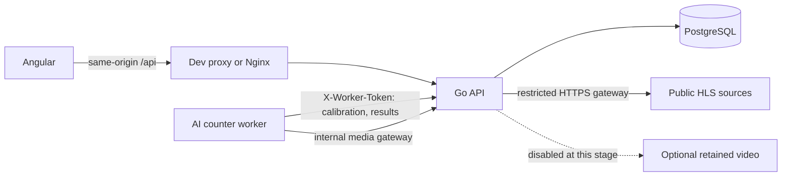

# TrafficBet Demo

[](https://github.com/TykhonRepeshko/trafficbet-demo/actions/workflows/checks.yml)

**A full-stack traffic prediction app with virtual credits, live road cameras and an auditable balance ledger.**

Built with **Go, Angular 21 and PostgreSQL 16**, packaged as separate Docker Compose services. Users enter an inclusive vehicle-count range for a scheduled round, or choose Over / Under against its reference threshold. The project demonstrates transactional account operations, authorization, safe media delivery and **fully automatic, human-free counting and settlement** by a computer-vision worker.

**Current stage:** working local portfolio prototype. Credits have no monetary value. An AI worker (`counter/`) detects and tracks vehicles, calibrates each camera's counting line by itself and reports every round; the API settles counted rounds and refunds unverifiable ones with no operator involved. Public production deployment is not configured. Retained-video capture and its annotation workspace are paused to avoid local video storage.

## What it does

- **Accounts:** registration, password sign-in, persistent balances, prediction history, password changes and session revocation. Registration opens an account with 10,000 virtual credits.
- **Predictions:** scheduled rounds, custom From / To count ranges, server-quoted demo odds, explicit stake confirmation, server-enforced deadlines, reviewed settlement and cancellation with a one-time refund. Accepted bounds and payouts are immutable; per-user idempotency protects against duplicate submissions. Published fixed Over / Under odds remain available.
- **Cameras:** six curated HLS views across Norway and the United States, reconnection handling, source resolution reporting and counting-line overlays in previews and fullscreen. Geometry appears after an operator configures a camera; drafts are labelled.
- **Administration:** user search and pagination, camera archive/restore, schedule configuration, live stake totals and participant/outcome drill-down. API authorization protects administration independently of navigation visibility.
- **Automatic counting:** YOLOX-Tiny detection (RF-DETR optional on GPU hosts), ByteTrack tracking and the frozen line-crossing rule; the capture clock is read from the camera's burned-in timestamp; coverage, clock and framing gates turn doubtful rounds into refunds. A watchdog refunds any round that receives no result in time. See [automatic counting](#automatic-counting).
- **Counting audit:** versioned rules, reference frames, source observations, immutable automatic results and an audit trail. Retained-video capture/playback and the annotation workspace are disabled at this stage; historical metadata remains preserved.
- **Interface:** a single play screen that fits one viewport without scrolling. *Make a prediction* shows a random live camera that is taking predictions; the player picks one of four ready-made ranges or types an exact number for higher odds, chooses a stake and confirms. The AI count then runs live on the video — synchronised with the frame on screen — and the result and payout appear when the window ends. Camera statistics are not shown. Light/dark themes, mobile navigation and a How it works guide remain. Stakes and results are calculated on the server.

For example, a winning **100 cr** prediction at **1.90** returns **190 cr including the stake**. A losing prediction returns zero; cancellation refunds the original 100 cr. Over means strictly greater than the threshold; Under or equal includes equality.

A custom range of **12–25** wins for any verified count from 12 through 25, including both bounds. Go quotes the range using the explicit `demo_geometric_v1` simulation rule: a geometric count distribution with mean `threshold + 0.5`, a 5% model margin, downward odds rounding to two decimals, and a 1×–100× return cap. This is not a probability model fitted to real traffic. Very broad ranges can return only the original stake. The server recomputes and checks the quoted terms before debiting; editing inputs never places a prediction.

## Architecture



Go owns account permissions, credits, scheduling and source access. PostgreSQL transactions and row locks serialize competing credit operations; unique ledger records and idempotency keys prevent repeated payouts/refunds/debits. Published rules and accepted round terms remain fixed.

Angular provides the interface and calls relative `/api` paths. It receives scoped media URLs instead of upstream configuration. Nginx serves the production frontend and proxies requests to Go. Docker runs migrations with a separate owner login, then starts the API with a restricted database role.

| Component | Version / purpose |
| --- | --- |
| Go | 1.26.10 minimum; HTTP API, scheduling, media gateway |
| Angular / TypeScript | 21 / 5.9; standalone components and RxJS |
| Node.js | 24 for frontend builds and regression tests |
| PostgreSQL | 16; persistent data, constraints and SQL migrations |
| Nginx / Docker Compose | Frontend delivery and isolated service deployment |
| FFmpeg / ffprobe | Optional bounded retained-video processing, currently disabled |
| Python 3.12 worker | YOLOX-Tiny (ONNX Runtime, Apache-2.0), ByteTrack (`trackers`), Tesseract OCR for the capture clock |

## Run locally

### Fresh checkout: Docker

Install **Docker Desktop with the Linux engine running** and **PowerShell 7**. From the repository root in PowerShell 7:

```powershell
.\scripts\setup.ps1
docker compose up --build -d
```

Open **[http://localhost:4200](http://localhost:4200)**. Only this loopback frontend port is published; API and database ports stay inside Docker networks. The first build compiles the restricted video decoder and can take several minutes.

Setup generates independent random credentials in the ignored `.env`. For the optional local seed, use `admin@example.com` with `DEMO_ADMIN_PASSWORD`, or `player@example.com` with `DEMO_PLAYER_PASSWORD`; read these values privately from your own `.env`. There are no shared passwords. Existing account credentials are preserved. Use `/register` for a normal account and `/admin` for administrator access.

```powershell
docker compose down                 # Stop; retain saved data
docker compose up --build -d         # Rebuild and start after source changes
```

PostgreSQL and optional retained footage use separate named volumes. Video capture defaults to `VIDEO_EVIDENCE_ENABLED=false`, and its volume remains empty during normal use. **Do not add `-v` to normal shutdown commands:** deleting volumes removes stored data. Fresh volumes have no operator-created counting profiles or annotations.

### This prepared Windows workspace: native mode

```powershell
.\start.cmd
.\stop.cmd
```

This mode uses the separately prepared Go/Node/PostgreSQL/video tools on this computer. Those runtimes are not included in Git. Go binds `127.0.0.1:8080`, PostgreSQL binds `127.0.0.1:55433`, and Angular serves `localhost:4200`.

The launcher keeps an existing native database as the default. Stop native mode before using Docker on the same frontend port. **Native storage and Docker storage are independent**: switching modes does not migrate accounts. Keep `.env` and `.local-data/postgres` private and backed up together. If video storage is reintroduced, retained files must accompany their database snapshot. See [verified transfer and recovery](docs/23-docker-verification.md).

## Rounds, video and AI boundaries

Automatic schedules keep **two future published rounds accepting entries**, so a member can predict the next interval while the earlier round is locked or counting. The default cadence is **a new 30-second count every 60 seconds**, with a 30-second pause between counting windows. Entries close **30 seconds before each count**; this safety gap does not add to the cadence. The nearest accepting round usually starts counting in **30–90 seconds**. New deadlines provide at least 30 seconds of entry notice, so startup, downtime or already published windows can temporarily increase that wait. Successors are published early and can accept predictions for longer. Counting windows do not overlap. Administrators can change settings for newly published rounds; existing times, odds and accepted predictions stay fixed. Go must remain running to replenish the queue; the scheduler itself never invents counts — results come only from the AI worker. A cutoff gap alone does not establish source timing or prevent independent access to public footage.

A stream that plays successfully does not prove exact sensor capture time or complete footage. Source operators can interrupt, reposition or blur a camera. There is no intentionally added delay buffer, and public camera access cannot prevent somebody watching the operator's source independently.

Unverifiable rounds are cancelled and refunded automatically: by the worker when a quality gate fails, and by the API watchdog when no result arrives in time. Clip-relative annotations support offline evaluation; they are not a completed training dataset or proof of counting accuracy.

### Automatic counting

The `counter` service runs without an operator:

1. **Media and clock.** It reads each HLS camera through the API's internal media gateway. The public sources carry no `EXT-X-PROGRAM-DATE-TIME`, so each segment is anchored to the camera's burned-in timestamp (Tesseract OCR, refined to the second tick, about ±20 ms). A camera without a readable clock (currently the Caltrans view) or without a calibrated line yet is reported unavailable: the API pauses its schedule, refunds its open rounds and shows the reason on the camera card, and resumes it automatically once both are in place.
2. **Calibration.** A camera without an approved profile is observed for about two minutes. The counting line is placed perpendicular to the dominant traffic flow where most trajectories pass, and is uploaded with a reference frame. Calibration runs at low CPU priority so it never delays round counting; without enough traffic (night, privacy blur) it retries with an increasing pause of up to 30 minutes. The API stores and approves it as a new profile version; rounds published afterwards freeze it.
3. **Counting (live).** Detection runs around the line, or over the whole frame on cameras where a periodic probe shows that it finds clearly more vehicles. Segments are fed to the round's tracker as soon as they arrive, and the running count with per-crossing capture times is published for viewers. Each round is analysed at 5 fps: detection on tiles around the line, ByteTrack, bottom-centre anchor, the first allowed crossing per track — the same rule as the Go `crossingCandidate`.
4. **Quality gates.** Complete footage for the window, at least 90% of sample frames, an OCR clock anchor and an unchanged view versus the reference. Any failure becomes `invalid` with a reason and a full refund. Repeated camera movement triggers recalibration.
5. **Threshold.** After five AI counts, new rounds use the median recent count (rescaled to the counting length) as the Over/Under line, so the odds follow real traffic.
6. **Settlement.** `POST /api/internal/automation/rounds/{id}/result` records an immutable result and settles or refunds in the same transaction. Results are idempotent. Versioned rounds without a result 10 minutes after the window are refunded; legacy rounds without a frozen line are refunded immediately.

Counting windows of different cameras are staggered 20 s apart (`ROUND_STAGGER`), which spreads the worker's load. Throughput: on the Apple M4 Docker VM used for development a 30-second round is analysed in 20–35 s, with three rounds in parallel, which covers five cameras on a one-minute cadence. A restart of the worker loses its in-memory footage buffer, so rounds whose window began before the restart are refunded.

Limits: vehicles pixelated by the camera operator cannot be detected (on several Norwegian cameras that covers the lanes nearest the camera, so the line sits where vehicles are small), night and low light reduce recall, and the count is a model estimate rather than a certified measurement. YOLOX-Tiny is the default because RF-DETR runs at 0.2–0.9 s per frame on this CPU-only Docker VM; build the worker with `--build-arg WITH_RFDETR=1` and set `COUNTER_MODEL=rfdetr-small` on a GPU host. Disable everything with `AUTOMATIC_SETTLEMENT_ENABLED=false` and by stopping the `counter` service. See [`counter/README.md`](counter/README.md).

On 25 October, local retained-video storage was released and immutable retirement records were added. Historical capture/annotation metadata remains, while retired media is excluded from playback, annotation, settlement evidence, storage budgets and new transfer bundles. Reintroducing evidence must cover the entire counting interval (currently 30 seconds), with continuity and timing checks; clip length alone is insufficient. Disabling capture does not relax versioned settlement requirements.

## Security and deployment scope

Implemented controls include bcrypt password hashes, hashed opaque HttpOnly/SameSite session cookies, server-side roles, exact Origin checks, strict bounded JSON, parameterized SQL and transaction-based credit operations. The media gateway uses exact HTTPS host allowlists, DNS/IP validation, pinned connections, certificate verification and bounded source-scoped resource handles. Public geometry excludes private operator notes.

Docker API/Nginx services run without root, with read-only root filesystems, dropped capabilities and `no-new-privileges`. Migration and runtime database credentials are separate. Native local startup still uses the database owner and is not equivalent to that Docker restriction.

Local HTTP is for loopback development. Public deployment requires HTTPS, secure cookies, an exact HTTPS frontend Origin, production configuration and infrastructure review. Email ownership verification, SMTP recovery, production load testing and operational monitoring remain unfinished. Virtual credits do not remove account-security requirements.

Dependency scans are point-in-time checks. Scoped overrides pin Undici 7.30.1 for Angular's builder and glob 14.0.3 / minimatch 11.0.3 within Angular CLI 21. The latter fix the two advisories behind the earlier 16 moderate development-dependency findings. Compatibility checks exercise package preparation, ignore rules, delegated update targets and cache verification. Angular remains on version 21; CI audits the full dependency tree at moderate severity. The Go toolchain minimum includes the October certificate-verification fix. Historical and current image findings are recorded in [Docker verification](docs/23-docker-verification.md); this project does not claim a vulnerability-free deployment.

## Verification

For the prepared native workspace:

```powershell
.\check.cmd -IntegrationTests -Preview
```

This requires the separate QA PostgreSQL cluster on port 55432 to be running. Without it, use `check.cmd` for unit/frontend/build checks; it reports skipped integration checks explicitly. The runner never uses the application's database as a fallback.

With Docker ready:

```powershell
.\scripts\smoke-docker.ps1
```

The smoke test builds a disposable complete stack on port 4201, checks production-proxy behavior, account debit/refund/re-login, authorization and database runtime privileges, then removes its own resources. Linux Go/PostgreSQL/decoder tests and backup/restoration checks are documented in [testing](docs/09-testing.md).

The **24 October 2026 checkpoint** passes 206 Go unit tests/subtests, 73 separately selected PostgreSQL tests/subtests, 135 Angular regressions, both frontend builds, Linux decoder tests, 100 Docker smoke assertions and 1,326 restore assertions. All six cameras were observed and decoded for 15 minutes each; one source recovered four transient request errors. Dependency audits and remaining image findings are recorded in the linked verification documents. Automated checks do not replace a rendered browser walkthrough; that remains a separate manual acceptance step. A pinned GitHub Actions workflow provides repeatable checks; see the [current hosted results](https://github.com/TykhonRepeshko/trafficbet-demo/actions/workflows/checks.yml) for the published revision.

## Project map

| Path | Contents |
| --- | --- |
| `backend/cmd/` | API, migration, admin and backup/restore entry points |
| `backend/internal/app/` | HTTP handlers, transactional store, security, media and tests |
| `backend/internal/app/migrations/` | Ordered immutable PostgreSQL schema migrations |
| `frontend/src/app/` | Angular pages, services, components and regression tests |
| `counter/` | Python AI worker: detection, tracking, OCR clock, calibration and quality gates |
| `postgres/` | PostgreSQL image maintenance |
| `scripts/` | Launch, verification, camera observation and recovery tools |
| `.github/workflows/` | CI definition |

Further reading: [architecture](docs/02-architecture.md) · [API](docs/03-api.md) · [security](docs/07-security.md) · [project defence questions](docs/interview-questions.md).

## Camera attribution

Five views are provided by the **Norwegian Public Roads Administration (Statens vegvesen)** under [NLOD 2.0](https://data.norge.no/nlod/en/2.0). The I-80 Bay Bridge Incline view is provided by **Caltrans**; see its [camera catalog](https://cwwp2.dot.ca.gov/documentation/cctv/cctv.htm) and [conditions of use](https://dot.ca.gov/conditions-of-use). Camera content remains subject to its provider's terms. Preview stills are dated reference images, not live video.

## Development acknowledgement

Developed with assistance from **OpenAI Codex** for implementation, testing and documentation.
