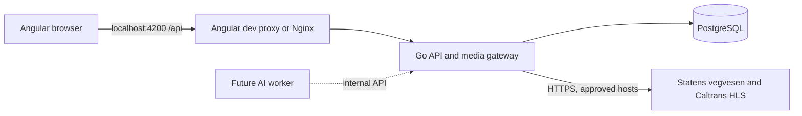

# Architecture and stack

A modular Go monolith handles accounts, sessions, cameras, predictions, settlement, cancellation/refunds, the ledger and the media gateway. Angular calls `/api` on the same origin. PostgreSQL stores persistent data. A future separate AI worker will submit measurements through the internal API.

The worker is not implemented. The media gateway already runs inside the Go API; there is no separate media container. YouTube is supported as an optional official nocookie embed, but the active catalog uses HLS.

## Launch modes

| Component | Native local mode | Docker Compose |
| --- | --- | --- |
| Frontend | Angular dev server, localhost:4200 | Angular build/Nginx, 127.0.0.1:4200 |
| Go API | 127.0.0.1:8080 | Docker network only, no host port |
| PostgreSQL | 127.0.0.1:55433 | Separate internal Docker network |
| Persistent storage | `.local-data/postgres` | Named volume `postgres_data` |
| Proxy | Angular `/api` | Nginx `/api`, public `/api/internal/` blocked |

`start.cmd` chooses available PowerShell 7 and invokes `start.ps1`. Normal native startup stays in the background after closing the terminal. `stop.cmd` invokes `stop-local.ps1` and stops this project's processes while preserving the database. `-Foreground` keeps logs in the current terminal. An existing native database keeps native mode as the default. `-Local` explicitly selects it; `-Docker` requires a ready Docker engine and stopped native services. Fresh checkouts select available Docker or need separately prepared native dependencies.

Prepared local runtimes live in the ignored `.tools` directory on this computer and are not committed. Local and Docker data stores are separate. Migration between them requires a verified `pg_dump`/`pg_restore` process. Restarting or updating does not require deleting a database. Preserve `.env` with local data.

## Versions and containers

| Component | Project version |
| --- | --- |
| Go | 1.26.10 minimum |
| Angular | 21 |
| Node.js for builds | 24 |
| TypeScript | 5.9 |
| PostgreSQL | 16 |

Go modules and the npm lockfile pin dependencies. Patch releases and images must be maintained. Compose combines separate frontend, backend and PostgreSQL images. API/Nginx run without root, with read-only filesystems, dropped capabilities and `no-new-privileges`. Resource limits are PostgreSQL 1 GiB/2 CPUs, API 512 MiB/2 CPUs, and frontend 128 MiB/1 CPU. Docker Desktop is installed; disposable Linux backend/PostgreSQL tests and production-proxy HTTP smoke checks passed. These checks do not establish capacity under production load.

## Data and transactions

`users` stores password hashes, roles and virtual balances. `auth_sessions` stores hashes of random session tokens. `streams` records source configuration, owner and attribution. `bet_markets` records thresholds, deadlines, outcomes and cancellation reasons. `bets` fixes each stake and potential payout. `credit_ledger` records movements; `audit_events` records actors/actions. `stream_metrics` stores manual/AI interval measurements. `ai_detections` is a future schema placeholder; no detector is running.

Registration creates the account, opening ledger entry and session atomically. Placement, settlement and cancellation use database transactions and locks. Per-user idempotency prevents duplicate debit after a lost response. Market locking serializes settlement, cancellation and new entries; refunds have a unique per-bet ledger record. Existing history is preserved.

Docker runs migrations in a short-lived `migrate` service and gives the HTTP API a restricted runtime login. Native local startup still performs owner migrations. Migrations run sequentially under a PostgreSQL advisory transaction lock. Applied migrations are immutable. Migration `005_fair_rounds.sql` adds refund ledger support, persisted cancellation reasons and a minimum 30-second observation lead for new/rescheduled rounds without rewriting historical deadlines.

## Browser and gateway boundary

Public camera responses expose `/api/media/streams/{id}/...`; only the admin API exposes full upstream URLs. HLS nested resources become short-lived opaque handles scoped to a camera/source fingerprint. There is no arbitrary `?url=` proxy. Exact approved hosts, public DNS/IP addresses, pinned connections and TLS verification protect outbound access.

The current allowlist contains `kamera.vegvesen.no`, `wzmedia.dot.ca.gov` and `cwwp2.dot.ca.gov`. The embedded `camera_catalog.json` supplies fresh optional seed data; startup never replaces an existing catalog. Adding a source requires approving all its playlist/segment/CDN hosts and verifying continuous road-camera content. A configured stream type alone does not prove live content, unchanged framing or frame coverage. There is no intentional delay buffer; betting cutoff and capture-time validation are distinct from playback latency.

Design preview is a separate Angular configuration using temporary memory data. It is excluded from the production build and does not take part in normal startup. The native stack runs locally; disposable Docker HTTP behavior was verified. Automated browser visual/click testing remains unperformed because the browser tool blocked the local URL.

Retained video uses bounded local FFmpeg/ffprobe tools inside the Go workflow, not an AI service. Frozen counting profiles and retained evidence support clip-relative annotations; versioned UTC settlement requires trusted complete matching capture evidence. See [current preparation](20-local-preparation.md) and [Docker verification](23-docker-verification.md).
